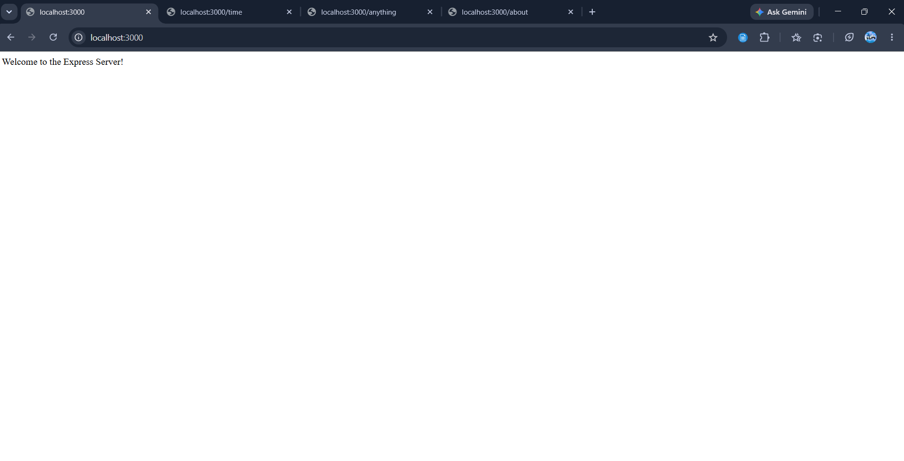
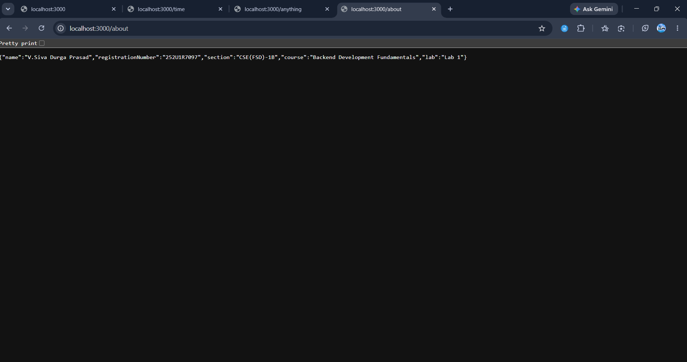
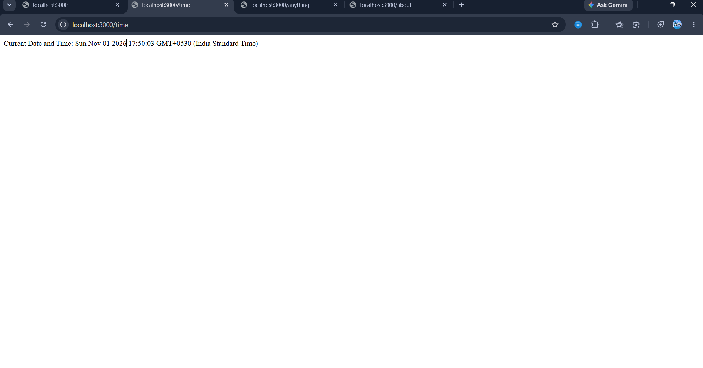

# Lab 1: Node.js and Express Server

## Student Details

| Field               | Details                          |
|---------------------|----------------------------------|
| **Name**            | V.Siva Durga Prasad              |
| **Registration No** | 252U1R7097                       |
| **Section**         | CSE(FSD)-1B                      |
| **Course**          | Backend Development Fundamentals |
| **Lab Number**      | Lab 1                            |

---

## Live Link

https://expressjslab-iota.vercel.app/

## Objective

The objective of this lab is to:

1. Initialize a Node.js project using `npm init -y`.
2. Understand the fields in `package.json`.
3. Install Express.js using `npm install express`.
4. Create a basic HTTP server using Node.js's built-in `http` module.
5. Create an Express server using `const app = express()`.
6. Run the server on port `3000`.
7. Implement required routes and return correct HTTP status codes.
8. Test and document all routes with screenshots.

---

## Technologies Used

- **Node.js** — JavaScript runtime environment
- **Express.js** — Web framework for Node.js
- **npm** — Node Package Manager
- **Built-in `http` module** — Node.js core module for creating HTTP servers

---

## Project Structure

```
lab-01/
├── server-http.js       ← Basic HTTP server (Node.js http module)
├── server.js            ← Express server with all routes
├── package.json         ← Project metadata and dependencies
├── package-lock.json    ← Exact dependency tree (auto-generated)
├── .gitignore           ← Files excluded from Git tracking
├── README.md            ← Project documentation
└── screenshots/
    ├── home.png         ← GET / response
    ├── about.png        ← GET /about response
    ├── time.png         ← GET /time response
    └── not-found.png    ← 404 response from unknown route
```

---

## Understanding `package.json` Fields

After running `npm init -y`, the following `package.json` was generated:

```json
{
  "name": "lab-01-nodejs-express-server",
  "version": "1.0.0",
  "description": "Lab 1 - Node.js and Express Server",
  "main": "server.js",
  "scripts": {
    "start": "node server.js",
    "start:http": "node server-http.js",
    "test": "echo \"Error: no test specified\" && exit 1"
  },
  "author": "V.Siva Durga Prasad",
  "license": "ISC",
  "dependencies": {
    "express": "^5.3.0"
  }
}
```

| Field           | Explanation                                                                 |
|----------------|-----------------------------------------------------------------------------|
| `name`         | The name of your project/package. Must be lowercase and URL-safe.           |
| `version`      | The current version of the project (follows semantic versioning: major.minor.patch). |
| `description`  | A short description of what this project does.                              |
| `main`         | The entry point file that runs when the package is required by another app. |
| `scripts`      | Custom command shortcuts. `npm start` runs `node server.js`, etc.           |
| `author`       | The author or creator of the project.                                       |
| `license`      | The software license type (ISC is a permissive open-source license).        |
| `dependencies` | Lists packages that are required for the app to run (e.g., `express`).     |

> **Note:** `node_modules/` is **not** listed in `package.json` — it is generated automatically by `npm install` and should never be committed to Git.

---

## Installation and Setup

### Step 1: Clone or navigate to the project folder

```bash
cd lab-01
```

### Step 2: Install dependencies

```bash
npm install
```

This reads `package.json` and installs all listed dependencies (Express) into `node_modules/`.

---

## Steps to Run

### Run the Express Server

```bash
node server.js
```

Expected output in terminal:
```
Express server is running at http://localhost:3000
```

### How to Run the Basic HTTP Server

```bash
node server-http.js
```

Expected output in terminal:
```
Basic HTTP server is running at http://localhost:3000
```

> **Note:** Only run one server at a time. Both use port `3000`. Stop a running server with `Ctrl + C` before starting the other.

---

## Endpoints

| Method | Endpoint      | Description                        | Expected Status |
|--------|---------------|------------------------------------|-----------------|
| GET    | `/`           | Welcome message                    | 200 OK          |
| GET    | `/about`      | Student name and section in JSON   | 200 OK          |
| GET    | `/time`       | Current date and time              | 200 OK          |
| GET    | `/anything`   | Unknown route demonstration        | 404 Not Found   |

> **Note:** `/anything` is just an example. Any undefined path (e.g., `/hello`, `/xyz`, `/test`) will also return `404 Not Found`.

### Test Commands (PowerShell)

```powershell
# Test GET /
Invoke-WebRequest -Uri http://localhost:3000/ -UseBasicParsing

# Test GET /about
Invoke-WebRequest -Uri http://localhost:3000/about -UseBasicParsing

# Test GET /time
Invoke-WebRequest -Uri http://localhost:3000/time -UseBasicParsing

# Test 404 - unknown route
Invoke-WebRequest -Uri http://localhost:3000/anything -UseBasicParsing
```

Or open the URLs directly in your browser.

---

## Screenshots

### GET / — Welcome Message (200 OK)



### GET /about — Student Details in JSON (200 OK)



### GET /time — Current Date and Time (200 OK)



### GET /anything — 404 Not Found


---

## HTTP Status Codes

| Status Code | Meaning       | When Used in This Lab                        |
|-------------|---------------|----------------------------------------------|
| `200 OK`    | Success       | Returned by `/`, `/about`, and `/time`       |
| `404 Not Found` | Route not found | Returned by any undefined/unknown path |

---

## Viva Questions and Answers

### Q1: What is the difference between `package.json` and `node_modules`?

**`package.json`** is a configuration file that lists the project's metadata and its dependencies (the names and version ranges of packages it needs). It is committed to Git.

**`node_modules/`** is a directory that contains the actual installed code of those dependencies. It is generated automatically when you run `npm install` and should **never** be committed to Git because it can be regenerated at any time from `package.json`.

---

### Q2: What does `app.listen()` do?

`app.listen(PORT, callback)` starts the Express server and makes it listen for incoming HTTP requests on the specified port number. The callback function runs once the server successfully starts. For example:

```js
app.listen(3000, () => {
  console.log('Server is running at http://localhost:3000');
});
```

Without this call, the Express application is defined but not actually running.

---

### Q3: What do `request` and `response` represent?

In Express route handlers, the callback receives two objects:

- **`req` (request):** Represents the incoming HTTP request from the client. It contains information like the URL, HTTP method, headers, query parameters, and request body.

- **`res` (response):** Represents the outgoing HTTP response that the server sends back to the client. Methods like `res.send()`, `res.json()`, and `res.status()` are used to build and send the response.

```js
app.get('/', (req, res) => {
  // req = incoming request details
  // res = what we send back to the browser
  res.status(200).send('Welcome!');
});
```

---

## Problems Faced and Solutions

| Problem | Solution |
|---------|----------|
| `npm init` produced `"main": "index.js"` by default | Manually updated `package.json` to set `"main": "server.js"` to match the actual entry point |
| Both servers use port `3000`, causing `EADDRINUSE` error when both are started simultaneously | Must stop one server (`Ctrl + C`) before starting the other |

---

## Git and Repository Notes

- `node_modules/` is excluded via `.gitignore` — do not commit it.
- `.env` is excluded via `.gitignore` — never expose secrets.
- `package-lock.json` is generated by npm and should be committed (it records exact dependency versions).
- To initialize Git and push this project:

```bash
git init
git add .
git commit -m "Lab 1: Node.js and Express Server"
git remote add origin <your-repository-url>
git push -u origin main
```
