# Lab 3: REST API, query parameters, validation, debugging

**Name:** Veerla Siva Durga Prasad
**Registration Number:** 252U1R7097
**Section:** CSE FSD - 2B
**Course:** Backend Development Fundamentals

## Live Link

[ADD YOUR RENDER URL HERE]

On Render's free plan the service sleeps after 15 minutes without traffic, so the first request can take about a minute. The free plan also does not keep files between restarts, so any book added, changed or deleted through the live link is lost on restart and the database goes back to its 10 starting rows.

## Objective

Turn the Lab 2 routes into a clean REST API that supports search, sorting, pagination and a price filter, validates its input, returns the correct status code every time, and answers all errors in one consistent JSON format. The lab also includes a debugging exercise on four common errors.

## How to Run

Requirements: Node.js and npm. No environment variables are needed. The server uses `PORT` if it is set and 3000 otherwise.

```
cd lab-03
npm install
npm start
```

To restart automatically whenever a file changes while developing:

```
npm run dev
```

Packages: `express`, `sqlite`, `sqlite3` (pinned to 5.1.7 so it installs on Render) and `nodemon` (development only).

The database is `books.db` with one table: `book(id INTEGER PRIMARY KEY, title TEXT, author TEXT, price INTEGER, pages INTEGER)`. To rebuild it with the 10 starting books, run `seed.sql` against `books.db` (for example `sqlite3 books.db < seed.sql`).

## Endpoints

Endpoints are nouns (`/books`). The HTTP method says what to do.

| Method | Path | Description | Success status |
| --- | --- | --- | --- |
| GET | `/books/` | List books with search, sorting, pagination and price filter | 200 |
| GET | `/books/:bookId/` | Get one book by id | 200 |
| POST | `/books/` | Add a book from the JSON body | 201 |
| PUT | `/books/:bookId/` | Replace all fields of an existing book | 200 |
| DELETE | `/books/:bookId/` | Delete a book | 200 |

### Query parameters for GET /books/

| Parameter | Meaning | Default | Allowed values |
| --- | --- | --- | --- |
| `search_q` | Partial, case-insensitive match on the title (`LIKE`) | empty (matches all) | any text |
| `order_by` | Column to sort by | `id` | `id`, `title`, `author`, `price`, `pages` |
| `order` | Sort direction | `ASC` | `ASC`, `DESC` |
| `limit` | How many books to return | 10 | whole number, 1 to 100 |
| `offset` | How many books to skip | 0 | whole number, 0 or more |
| `min_price` | Lowest price to include | 0 | whole number, 0 or more |
| `max_price` | Highest price to include | 2147483647 | whole number, 0 or more |

Example: `/books/?search_q=data&min_price=500&max_price=1500&order_by=price&order=DESC&limit=5&offset=0`

All values reach SQLite through `?` placeholders. Column names and `ASC`/`DESC` cannot be placeholders, so `order_by` and `order` are checked against a fixed list first and anything else gets a 400. The characters `%` and `_` in `search_q` are escaped so `LIKE` matches them as plain text.

### Request body for POST and PUT

```
{
  "title": "Book title",
  "author": "Author name",
  "price": 599,
  "pages": 300
}
```

`title` and `author` must be non-empty text. `price` and `pages` must be whole numbers, 0 or more. A price sent as text (for example `"abc"`) is rejected.

### Responses and status codes

Every error has the same shape: `{ "message": "..." }`.

| Situation | Status |
| --- | --- |
| Book created | 201 |
| Read, update or delete succeeded | 200 |
| Bad input: invalid or missing body field, bad id, bad query parameter, malformed JSON | 400 |
| Book id not found, or unknown route | 404 |

## Postman Tests

`lab-03.postman_collection.json` contains 30 requests, each with automatic checks on the status code and the response body. To use it, import the file into Postman, set the collection variable `baseUrl` (default `http://localhost:3000`, or the Render URL) and use **Run collection**. The request that creates a book saves its id in `newBookId`, and the update, read and delete requests after it use that id.

### Success cases

| # | Test | Request | Expected status |
| --- | --- | --- | --- |
| 01 | GET all books (defaults) | `GET /books/` | 200 |
| 02 | GET one book | `GET /books/4/` | 200 |
| 03 | Search by title (search_q=data) | `GET /books/?search_q=data` | 200 |
| 04 | Sort by price descending | `GET /books/?order_by=price&order=DESC&limit=5` | 200 |
| 05 | Pagination (limit=3, offset=3) | `GET /books/?limit=3&offset=3` | 200 |
| 06 | Price range (500 to 800) | `GET /books/?min_price=500&max_price=800` | 200 |
| 07 | All filters together | `GET /books/?search_q=o&min_price=400&max_price=1300&order_by=pages&order=DESC&limit=3&offset=1` | 200 |
| 08 | SQL injection text in search is harmless | `GET /books/?search_q=%27%20OR%201%3D1%20--` | 200 |
| 09 | POST create a book | `POST /books/` | 201 |
| 10 | PUT update the new book | `PUT /books/{{newBookId}}/` | 200 |
| 11 | GET the updated book | `GET /books/{{newBookId}}/` | 200 |
| 12 | DELETE the new book | `DELETE /books/{{newBookId}}/` | 200 |

### Failure cases

| # | Test | Request | Expected status |
| --- | --- | --- | --- |
| 13 | GET a book that does not exist | `GET /books/999/` | 404 |
| 14 | GET with a non-numeric id | `GET /books/abc/` | 400 |
| 15 | GET after delete returns 404 | `GET /books/{{newBookId}}/` | 404 |
| 16 | DELETE the same book again | `DELETE /books/{{newBookId}}/` | 404 |
| 17 | PUT a book that does not exist | `PUT /books/999/` | 404 |
| 18 | POST missing title | `POST /books/` | 400 |
| 19 | POST missing author | `POST /books/` | 400 |
| 20 | POST non-numeric price | `POST /books/` | 400 |
| 21 | POST negative price | `POST /books/` | 400 |
| 22 | POST malformed JSON | `POST /books/` | 400 |
| 23 | PUT with an invalid body | `PUT /books/1/` | 400 |
| 24 | Invalid order_by | `GET /books/?order_by=hack` | 400 |
| 25 | Invalid order | `GET /books/?order=SIDEWAYS` | 400 |
| 26 | limit is zero | `GET /books/?limit=0` | 400 |
| 27 | limit is not a number | `GET /books/?limit=abc` | 400 |
| 28 | negative offset | `GET /books/?offset=-1` | 400 |
| 29 | min_price greater than max_price | `GET /books/?min_price=900&max_price=100` | 400 |
| 30 | Unknown route | `GET /shelves/` | 404 |

## Screenshots

### Search by title

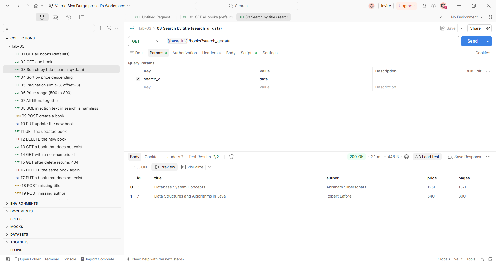

### Sort by price, descending

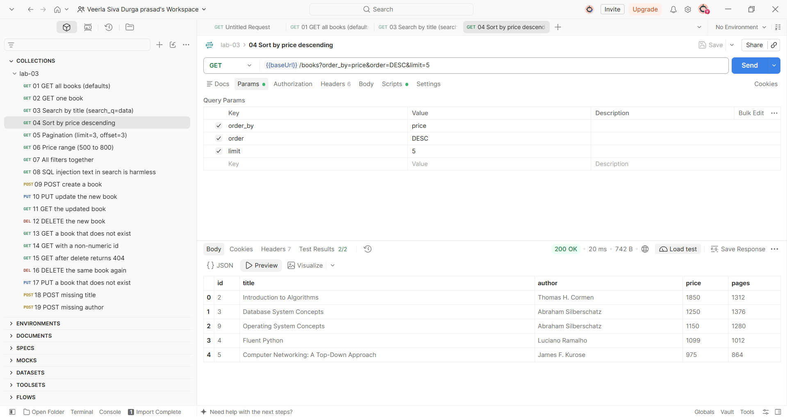

### Pagination

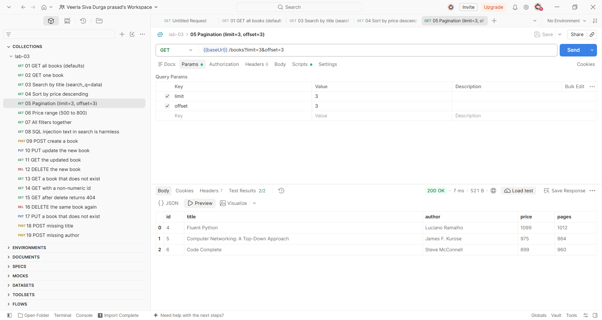

### Price range filter

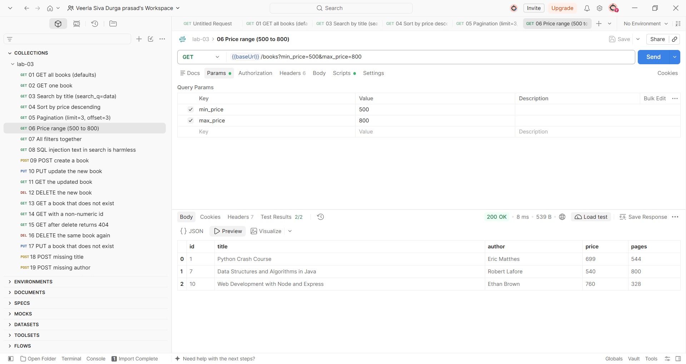

### POST creates a book (201)

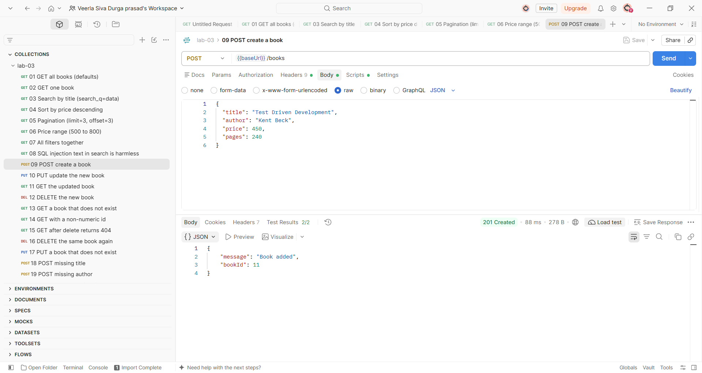

### PUT updates a book (200)

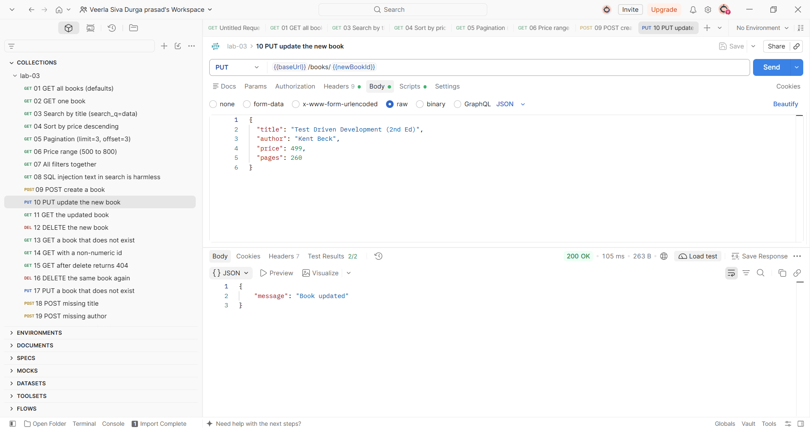

### DELETE removes a book (200)

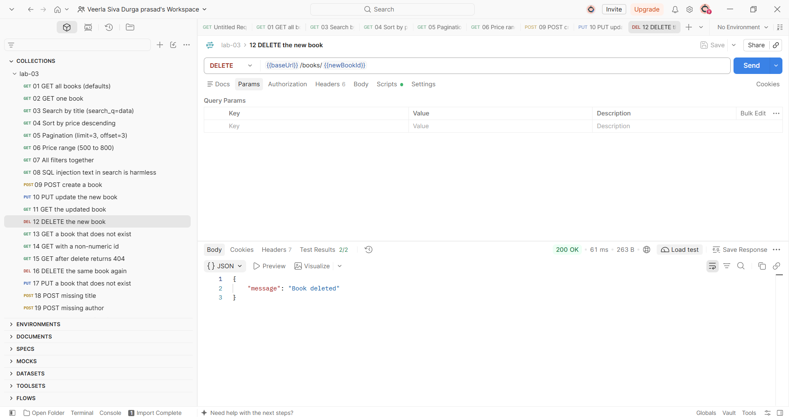

### Validation error: missing title (400)

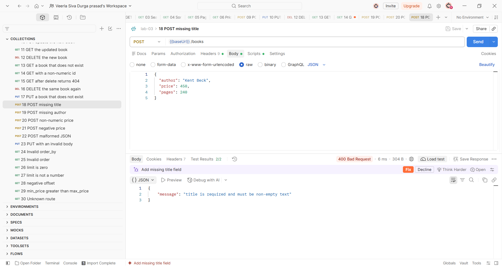

### Validation error: non-numeric price (400)

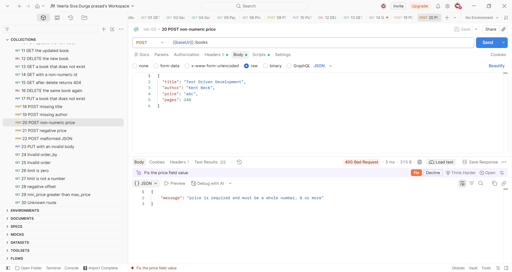

### Book not found (404)

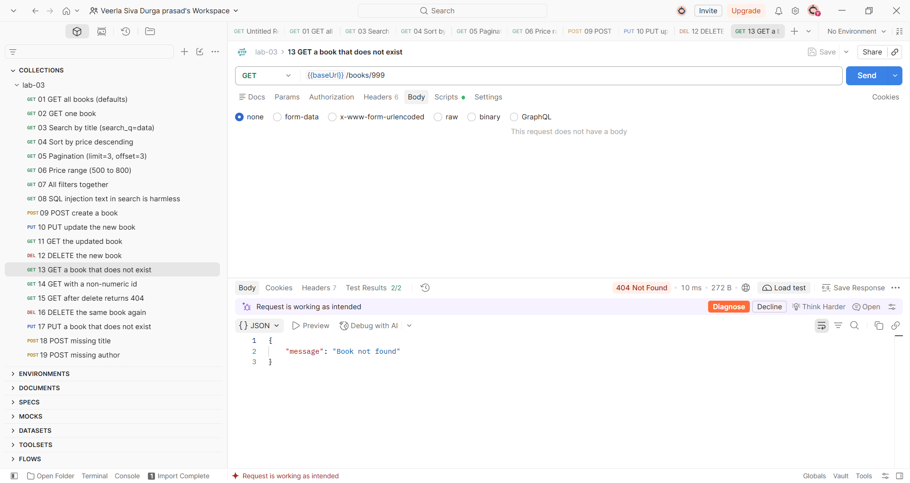

### All 30 Postman tests passing

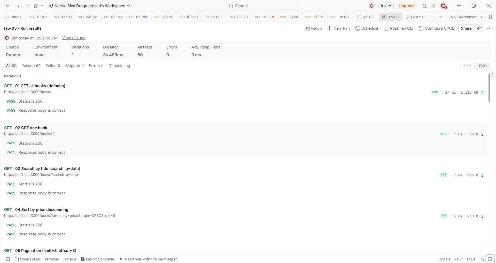

## Debugging Exercise

The faculty gave out a broken version of the project. The four errors I fixed:

| Error | Message I saw | Cause | Fix |
| --- | --- | --- | --- |
| Port conflict | `Error: listen EADDRINUSE: address already in use :::3000` | An earlier run of the server was still running and holding port 3000, so the new one could not listen on it. | Stopped the old Node process (or changed `PORT`) and started the server again. |
| Wrong import path | `Error: Cannot find module './sqlite'` | `require("./sqlite")` looks for a file called `sqlite` in the project folder. `sqlite` is an installed package, so it must be required by its name. | Changed it to `require("sqlite")`. |
| Table name typo | `SQLITE_ERROR: no such table: boook` | The SQL text said `boook` but the table is called `book`. | Corrected the table name in the query. |
| Missing await | `TypeError: db.all is not a function` | `open(...)` returns a Promise. Without `await`, `db` was a Promise, not the database object, when a route used it. | Added `await` before `open(...)` in the start-up function. |

## Notes

Problems faced and how I solved them:

- **Handling SQL Wildcards in Partial Search**: In the `GET /books/?search_q=...` route, special characters like `%` and `_` were initially interpreted by SQLite's `LIKE` operator as pattern wildcards instead of literal characters. I solved this by adding an `escapeForLike` helper function that escapes `\`, `%`, and `_`, and pairing it with `ESCAPE '\\'` in the SQL query so user searches remain literal and safe.
- **Dynamic Sorting Whitelist vs. SQL Injection**: SQLite parameterized placeholders (`?`) cannot be used for column names or `ASC`/`DESC` keywords in `ORDER BY`. To prevent SQL injection while allowing flexible sorting, I implemented strict whitelist validation (`SORT_FIELDS` array and checking for `ASC`/`DESC`), rejecting any invalid inputs with an HTTP 400 status before constructing the query.
- **Centralized Error Handling**: Express 5 automatically routes rejected Promises in async handlers to the error middleware, but returning consistent `{ "message": "..." }` responses across malformed JSON payloads and custom domain errors required a dedicated `HttpError` class and middleware check for `entity.parse.failed`.
